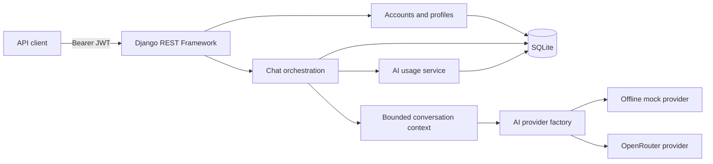

# NexaChat

> A secure, provider-agnostic chatbot REST API built with Django REST Framework.


NexaChat is a backend-only chatbot platform with JWT authentication, user
profiles, private chat sessions, password recovery, AI usage accounting, and a
complete synchronous chat workflow. Its AI layer supports a deterministic
offline provider for development and testing, plus an optional OpenRouter
adapter for live completions.

The codebase is deliberately provider-independent: API views and chat services
depend on a typed AI interface rather than a specific vendor SDK.

## Table of contents

- [Highlights](#highlights)
- [Technology](#technology)
- [Architecture](#architecture)
- [Quick start](#quick-start)
- [Configuration](#configuration)
- [AI providers](#ai-providers)
- [API documentation](#api-documentation)
- [API reference](#api-reference)
- [Example chat workflow](#example-chat-workflow)
- [Password reset](#password-reset)
- [Security design](#security-design)
- [Postman](#postman)
- [Testing](#testing)
- [Project structure](#project-structure)
- [Implementation status](#implementation-status)
- [Current scope](#current-scope)

## Highlights

### Accounts and authentication

- Registration with Django password validation
- JWT login, access-token refresh, rotation, and refresh-token blacklisting
- Authenticated logout with refresh-token ownership validation
- Current-user profile retrieval and updates
- Case-insensitive email uniqueness validation
- Secure, enumeration-resistant password reset

### Chat and AI

- User-owned chat sessions and chronologically ordered messages
- Queryset-level ownership enforcement for every chat resource
- Separate raw-message and complete-chat endpoints
- Provider-independent AI interface and provider factory
- Deterministic offline mock provider
- Optional OpenRouter chat-completions provider
- Bounded conversation context and server-controlled system prompt
- Automatic assistant-message and AI-usage persistence
- Safe handling of provider errors, timeouts, and invalid responses

### Observability and developer experience

- Per-request token, cost, model, and latency records
- Per-user usage history and aggregate summaries
- Swagger UI, ReDoc, and JSON/YAML OpenAPI schemas
- Importable Postman collection and local environment
- Offline provider-readiness diagnostics
- Comprehensive automated tests with no external AI dependency

## Technology

| Area | Technology |
| --- | --- |
| Language | Python 3.12+ |
| Web framework | Django 6.0.7 |
| API framework | Django REST Framework 3.17.1 |
| Authentication | SimpleJWT with refresh rotation and blacklisting |
| API documentation | drf-yasg / OpenAPI |
| AI transport | HTTPX |
| Environment loading | python-dotenv |
| Image support | Pillow |
| Database | SQLite |
| AI providers | Offline mock, OpenRouter |

Dependencies are pinned in [`requirements.txt`](requirements.txt).

## Architecture



The complete-chat flow deliberately avoids holding a database transaction open
while waiting for an external provider:

1. Resolve the session through the authenticated owner.
2. Validate and save the user message.
3. Build a bounded, chronological conversation context.
4. Invoke the selected provider outside an application transaction.
5. Atomically save the assistant message and its `AIUsage` record.

If the provider fails, the user message remains available for retry or
inspection, while no assistant message or usage record is created.

### Data relationships

```text
User ──1:1── UserProfile
User ──1:N── PasswordResetToken
User ──1:N── ChatSession ──1:N── ChatMessage
                      └──1:N── AIUsage ──N:1── ChatMessage
```

User and session deletion use database cascades for their related data.

## Quick start

### 1. Create a virtual environment

macOS or Linux:

```bash
python3 -m venv .venv
source .venv/bin/activate
```

Windows PowerShell:

```powershell
python -m venv .venv
.venv\Scripts\Activate.ps1
```

### 2. Install dependencies

```bash
python -m pip install --upgrade pip
pip install -r requirements.txt
```

### 3. Create the local environment file

```bash
cp .env.example .env
```

The example configuration uses the offline mock provider, so no external API
key is required for local development.

### 4. Prepare the database

```bash
python manage.py migrate
```

### 5. Start the API

```bash
python manage.py runserver
```

The development server is available at `http://127.0.0.1:8000`.

| Resource | URL |
| --- | --- |
| Health check | `http://127.0.0.1:8000/api/health/` |
| Swagger UI | `http://127.0.0.1:8000/api/docs/` |
| ReDoc | `http://127.0.0.1:8000/api/redoc/` |
| OpenAPI JSON | `http://127.0.0.1:8000/api/schema.json` |
| Django admin | `http://127.0.0.1:8000/admin/` |

Current health-check response, preserving the original Phase 1 contract:

```json
{
  "status": "ok",
  "project": "Chatbot DRF Backend",
  "phase": 1
}
```

## Configuration

NexaChat loads the project-root `.env` once, before reading any Django or AI
settings. Existing operating-system variables retain priority because
`python-dotenv` is used without `override=True`.

Never commit `.env`; it is excluded by [`.gitignore`](.gitignore). Keep real
credentials out of `.env.example`, Postman files, request bodies, and source
code.

### Django and account settings

| Variable | Default | Purpose |
| --- | --- | --- |
| `DJANGO_SECRET_KEY` | Insecure development fallback | Django signing key; required securely in production |
| `DJANGO_DEBUG` | `True` | Enables Django debug mode |
| `DJANGO_ALLOWED_HOSTS` | `127.0.0.1,localhost` | Comma-separated allowed hosts |
| `DJANGO_EMAIL_BACKEND` | Console backend | Password-reset email backend |
| `DJANGO_DEFAULT_FROM_EMAIL` | `NexaChat <no-reply@nexachat.local>` | Sender for reset messages |
| `PASSWORD_RESET_TOKEN_TTL_MINUTES` | `30` | Reset-token lifetime |

### AI settings

| Variable | Default | Purpose |
| --- | --- | --- |
| `AI_PROVIDER` | `mock` | Selected provider: `mock` or `openrouter` |
| `AI_REQUEST_TIMEOUT_SECONDS` | `30` | Provider request timeout |
| `AI_MAX_OUTPUT_TOKENS` | `512` | Maximum requested completion tokens |
| `AI_TEMPERATURE` | `0.7` | Completion temperature, from `0` to `2` |
| `AI_CONTEXT_MESSAGE_LIMIT` | `20` | Maximum conversation messages sent to the provider |
| `AI_SYSTEM_PROMPT` | Built-in NexaChat prompt | Server-owned provider instruction |
| `OPENROUTER_API_KEY` | Empty | Server-side OpenRouter credential |
| `OPENROUTER_MODEL` | Empty | OpenRouter model identifier |
| `OPENROUTER_BASE_URL` | `https://openrouter.ai/api/v1` | OpenRouter-compatible API base URL |
| `OPENROUTER_SITE_URL` | Empty | Optional `HTTP-Referer` value |
| `OPENROUTER_APP_NAME` | `NexaChat` | Optional OpenRouter application title |

See [`.env.example`](.env.example) for a complete local template.

## AI providers

| Capability | Mock | OpenRouter |
| --- | --- | --- |
| Network access | None | HTTPS request per completion |
| Credential required | No | Yes |
| Output | Deterministic echo response | Selected model response |
| Usage | Simulated token estimate, zero cost | Validated provider usage metadata |
| Recommended use | Development and automated tests | Explicit live testing and application use |

### Offline mock provider

The mock provider is the default. It echoes up to 500 characters from the
latest usable user message, calculates deterministic whitespace-based token
estimates, reports zero cost, and never reads OpenRouter credentials.

```dotenv
AI_PROVIDER=mock
```

### OpenRouter

Set these values in `.env`:

```dotenv
AI_PROVIDER=openrouter
OPENROUTER_API_KEY=<your-server-side-api-key>
OPENROUTER_MODEL=openrouter/free
```

The adapter sends an OpenAI-compatible, non-streaming
`POST /chat/completions` request to the configured base URL. The key is sent
only in the `Authorization: Bearer ...` header. TLS verification remains
enabled, and every request uses the configured timeout.

The provider validates response content, model metadata, token totals, cost,
and status codes before returning a typed result. It never silently falls back
to the mock provider when OpenRouter is selected incorrectly.

### Provider readiness commands

Check configuration without making a network request:

```bash
python manage.py check_ai_config
```

Run the provider test in configuration-only mode:

```bash
python manage.py test_ai_provider
```

Both commands avoid printing credentials. A real provider request requires the
explicit `--live` flag:

```bash
python manage.py test_ai_provider --live
python manage.py test_ai_provider --live --message "Reply with OK."
```

The live readiness command does not create `ChatMessage` or `AIUsage` records
and prints only safe response metadata.

## API documentation

Interactive documentation is generated from the implemented views and
serializers.

| Format | Endpoint |
| --- | --- |
| Swagger UI | `/api/docs/` |
| ReDoc | `/api/redoc/` |
| OpenAPI JSON | `/api/schema.json` |
| OpenAPI YAML | `/api/schema.yaml` |

Protected endpoints require an access token:

```http
Authorization: Bearer <access_token>
```

## API reference

### System

| Method | Endpoint | Access | Success |
| --- | --- | --- | --- |
| `GET` | `/api/health/` | Public | `200` |
| `GET` | `/api/docs/` | Public | `200` |
| `GET` | `/api/redoc/` | Public | `200` |
| `GET` | `/api/schema.json` | Public | `200` |

### Authentication and profile

| Method | Endpoint | Access | Success | Description |
| --- | --- | --- | --- | --- |
| `POST` | `/api/accounts/register/` | Public | `201` | Register and receive JWTs |
| `POST` | `/api/accounts/login/` | Public | `200` | Authenticate and receive JWTs |
| `POST` | `/api/accounts/token/refresh/` | Public | `200` | Rotate a refresh token |
| `POST` | `/api/accounts/logout/` | JWT | `200` | Blacklist an owned refresh token |
| `GET` | `/api/accounts/profile/` | JWT | `200` | Retrieve the current profile |
| `PUT` | `/api/accounts/profile/` | JWT | `200` | Replace editable profile fields |
| `PATCH` | `/api/accounts/profile/` | JWT | `200` | Partially update the profile |

### Password reset

| Method | Endpoint | Access | Success | Description |
| --- | --- | --- | --- | --- |
| `POST` | `/api/accounts/password-reset/request/` | Public | `200` | Request reset instructions |
| `POST` | `/api/accounts/password-reset/verify/` | Public | `200` | Verify a reset token |
| `POST` | `/api/accounts/password-reset/confirm/` | Public | `200` | Set a new password |

### Chat sessions and messages

| Method | Endpoint | Access | Success | Description |
| --- | --- | --- | --- | --- |
| `GET` | `/api/chats/sessions/` | JWT | `200` | List owned sessions |
| `POST` | `/api/chats/sessions/` | JWT | `201` | Create a session |
| `GET` | `/api/chats/sessions/<uuid>/` | JWT | `200` | Retrieve a session |
| `PUT` | `/api/chats/sessions/<uuid>/` | JWT | `200` | Replace editable session fields |
| `PATCH` | `/api/chats/sessions/<uuid>/` | JWT | `200` | Partially update a session |
| `DELETE` | `/api/chats/sessions/<uuid>/` | JWT | `204` | Delete a session and related data |
| `GET` | `/api/chats/sessions/<uuid>/messages/` | JWT | `200` | List session messages oldest-first |
| `POST` | `/api/chats/sessions/<uuid>/messages/` | JWT | `201` | Create only a user message |
| `GET` | `/api/chats/messages/<uuid>/` | JWT | `200` | Retrieve an owned message |
| `DELETE` | `/api/chats/messages/<uuid>/` | JWT | `204` | Delete an owned message |

### AI chat and usage

| Method | Endpoint | Access | Success | Description |
| --- | --- | --- | --- | --- |
| `POST` | `/api/chats/sessions/<uuid>/chat/` | JWT | `201` | Create a user message and AI response |
| `GET` | `/api/chats/usage/` | JWT | `200` | List the current user's usage |
| `GET` | `/api/chats/usage/summary/` | JWT | `200` | Aggregate the current user's usage |
| `GET` | `/api/chats/sessions/<uuid>/usage/` | JWT | `200` | List usage for an owned session |

List endpoints currently return unpaginated JSON arrays.

Common error statuses include:

- `400` — request validation failure
- `401` — missing or invalid JWT
- `404` — missing or unowned chat resource
- `502` — malformed or rejected provider response
- `503` — unavailable, rate-limited, unauthenticated, or misconfigured provider
- `504` — provider timeout

## Example chat workflow

### 1. Register

```http
POST /api/accounts/register/
Content-Type: application/json
```

```json
{
  "username": "alex",
  "email": "alex@example.com",
  "password": "StrongPass123!",
  "password_confirm": "StrongPass123!",
  "first_name": "Alex",
  "last_name": "Morgan"
}
```

A successful response contains the safe user summary plus `access` and
`refresh` JWTs.

### 2. Create a session

```http
POST /api/chats/sessions/
Authorization: Bearer <access_token>
Content-Type: application/json
```

```json
{
  "title": "Django questions",
  "model_name": "default",
  "system_prompt": "",
  "is_archived": false
}
```

Session ownership is assigned from the access token and cannot be selected by
the request body.

### 3. Complete a chat turn

```http
POST /api/chats/sessions/<session_uuid>/chat/
Authorization: Bearer <access_token>
Content-Type: application/json
```

```json
{
  "content": "What problem does Django REST Framework solve?"
}
```

Successful responses contain the persisted user message, assistant message,
and usage record:

```json
{
  "user_message": {
    "id": "<user_message_uuid>",
    "session": "<session_uuid>",
    "role": "user",
    "content": "What problem does Django REST Framework solve?",
    "status": "sent",
    "created_at": "<timestamp>",
    "updated_at": "<timestamp>"
  },
  "assistant_message": {
    "id": "<assistant_message_uuid>",
    "session": "<session_uuid>",
    "role": "assistant",
    "content": "<provider response>",
    "status": "sent",
    "created_at": "<timestamp>",
    "updated_at": "<timestamp>"
  },
  "usage": {
    "id": 1,
    "session": "<session_uuid>",
    "message": "<user_message_uuid>",
    "model_name": "<provider model>",
    "prompt_tokens": 24,
    "completion_tokens": 18,
    "total_tokens": 42,
    "cost": "0.000000",
    "latency_ms": 120,
    "created_at": "<timestamp>"
  }
}
```

The raw message endpoint,
`POST /api/chats/sessions/<session_uuid>/messages/`, intentionally creates only
a user message. It never invokes an AI provider or writes usage.

### AI context and failure behavior

- Only user and assistant messages from the owned session enter context.
- Context is bounded by `AI_CONTEXT_MESSAGE_LIMIT` and returned oldest-first.
- The new user message is included exactly once.
- `AI_SYSTEM_PROMPT` is controlled by the server and passed separately.
- Account data, JWTs, reset tokens, database IDs, and message metadata are not
  added to provider messages.
- Provider failures return a safe message and the persisted user-message UUID.
- Raw upstream response bodies, credentials, and stack traces are not returned.

## Password reset

The password-reset flow has three public steps:

1. Request instructions with an email address.
2. Verify the raw token delivered by email.
3. Confirm the token with a new password.

Local development uses Django's console email backend, so reset messages appear
in the `runserver` terminal. The API deliberately returns the same request
response for known, unknown, and inactive accounts.

Only a SHA-256 digest of each reset token is stored. Tokens expire after the
configured TTL, are single-use, and invalidate older unused tokens. Successful
confirmation:

- applies Django's password validators;
- requires the new password to differ from the current password;
- invalidates the user's remaining reset tokens; and
- blacklists outstanding SimpleJWT refresh tokens.

Existing access tokens cannot be blacklisted by the current architecture and
remain valid only until their configured 30-minute expiry.

## Security design

- All protected APIs use JWT authentication.
- Refresh tokens rotate and old refresh tokens are blacklisted.
- Chat and usage querysets are scoped to the authenticated user.
- Missing and unowned UUIDs both return `404`, reducing ownership disclosure.
- Clients cannot create assistant/system messages or submit trusted usage data.
- Password-reset requests resist account enumeration.
- Reset tokens are cryptographically generated and stored only as digests.
- Provider credentials remain server-side and are excluded from Postman.
- OpenRouter uses HTTPS, explicit timeouts, and validated response structures.
- Provider failures expose neither upstream bodies nor credentials.
- `.env`, the SQLite database, uploads, and local tooling artifacts are ignored.

The built-in secret key, debug mode, console email backend, SQLite database,
and Django development server are development defaults. Review and replace
them before production deployment.

## Postman

Import both files:

- [`postman/NexaChat.postman_collection.json`](postman/NexaChat.postman_collection.json)
- [`postman/NexaChat.local.postman_environment.json`](postman/NexaChat.local.postman_environment.json)

Select the **NexaChat Local** environment. Collection scripts save JWTs,
rotated refresh tokens, session UUIDs, and message UUIDs for later requests.
Protected requests inherit Bearer authentication.

For password reset, request a token, copy it from Django's local console email
into the Postman `reset_token` variable, and then run verify or confirm. The
OpenRouter API key is intentionally not included in either Postman file.

## Testing

Run the complete validation suite:

```bash
python manage.py makemigrations --check --dry-run
python manage.py migrate
python manage.py check
python manage.py test
python manage.py generate_swagger - --format json
python -m json.tool postman/NexaChat.postman_collection.json
python -m json.tool postman/NexaChat.local.postman_environment.json
```

The current baseline contains 217 passing tests. Tests use isolated settings,
stubs, mocks, or the deterministic mock provider and do not make external AI
requests.

Test coverage includes:

- models, signals, indexes, constraints, and cascades;
- registration, JWT lifecycle, profiles, and password reset;
- chat CRUD, ownership isolation, and status behavior;
- AI context construction and provider response validation;
- usage recording, aggregation, and transaction rollback;
- generated OpenAPI semantics;
- management-command network and secret-safety guarantees; and
- `.env` loading and operating-system precedence.

## Project structure

```text
NexaChat/
├── accounts/
│   ├── migrations/
│   ├── models.py
│   ├── serializers.py
│   ├── services.py
│   ├── signals.py
│   ├── tests.py
│   ├── urls.py
│   └── views.py
├── chats/
│   ├── ai/
│   │   ├── base.py
│   │   ├── context.py
│   │   ├── exceptions.py
│   │   ├── factory.py
│   │   ├── mock.py
│   │   └── openrouter.py
│   ├── management/commands/
│   │   ├── check_ai_config.py
│   │   └── test_ai_provider.py
│   ├── migrations/
│   ├── models.py
│   ├── serializers.py
│   ├── services.py
│   ├── signals.py
│   ├── urls.py
│   └── views.py
├── config/
│   ├── settings.py
│   ├── urls.py
│   ├── views.py
│   ├── asgi.py
│   └── wsgi.py
├── postman/
│   ├── NexaChat.postman_collection.json
│   └── NexaChat.local.postman_environment.json
├── .env.example
├── .gitignore
├── manage.py
├── README.md
└── requirements.txt
```

## Implementation status

| Phase | Delivered |
| --- | --- |
| Phase 1 | Django/DRF foundation, health check, documentation routes |
| Phase 2 | Profiles, reset tokens, chat models, usage model, migrations |
| Phase 3 | Registration, JWT lifecycle, current-user profile APIs |
| Phase 4 | Owned chat-session and message APIs |
| Phase 5 | Usage APIs and secure password reset |
| Phase 6 | Provider abstraction, mock/OpenRouter chat, automatic usage |

The Phase 1 structure and Phase 2 database schema remain preserved. Phases 3–6
did not require model or migration changes.

## Current scope

NexaChat currently provides a synchronous REST backend. The following are not
implemented:

- frontend or mobile clients;
- streaming, Server-Sent Events, or WebSockets;
- attachments, voice, or image chat;
- retrieval-augmented generation, embeddings, or vector search;
- chat sharing or real-time collaboration;
- background workers or scheduled jobs;
- billing, subscriptions, or payments; and
- model fine-tuning.
